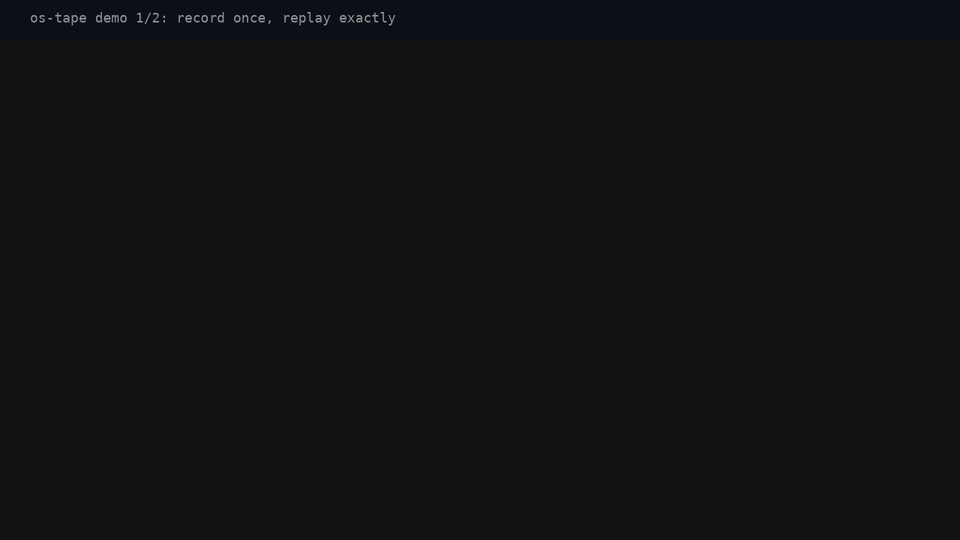
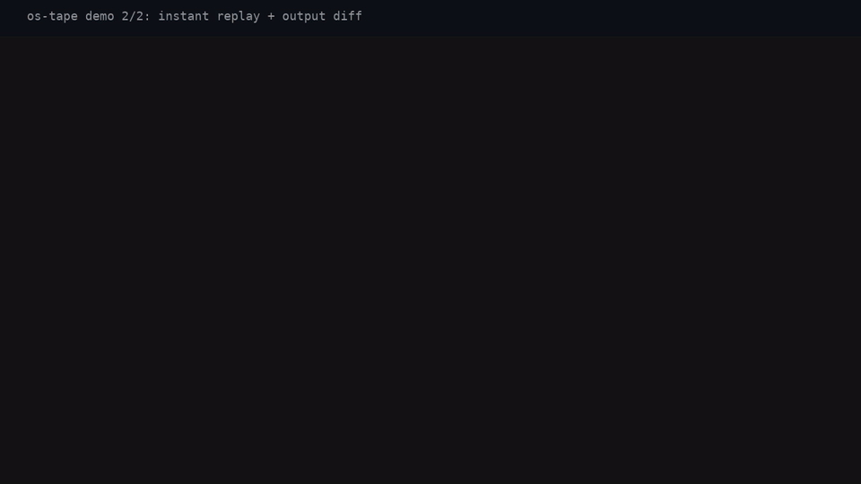

# os-tape: record a real run, replay it exactly

os-tape is a drop-in replacement for Pen's standard `os` system package. It
records every effect a program performs into a tape file, then replays that
tape without touching the disk, network, clock, or terminal. A crash seen
once in production becomes a tape, and the tape becomes a regression test
anyone can run offline.

## CLI

```sh
os-tape record [--package DIR] [--tape TAPE] -- ./app [args...]
os-tape replay [--diff] <tape> [-- ./app [args...]]
os-tape check [tapes/]
os-tape validate <tape>
os-tape info <tape>
os-tape cat <tape> --seq N
```

`os-tape --help` documents every command; `os-tape --version` prints the
release. Each command is spelled out with examples in the Quickstart below.

## Quickstart

Prerequisites: `pen` 0.6.9, LLVM 16 (`llc`, `llvm-config`, ...), `turtle`, a
Pen checkout exported as `PEN_ROOT`, Python 3.9+, and Rust (the FFI crates
pin 1.99.0 via `rust-toolchain.toml`). CI installs all of these — see
`.github/actions/setup-pen`.

1. **Swap the dependency.** In your app's `pen.json`, point `Os` at os-tape.
   No source change is needed: the compiler names the context field after
   the `pen.json` key, so code keeps saying `ctx.Os`.

```json
{
  "type": "application",
  "dependencies": {
    "Os": "git://github.com/johnproblems/pen-os-tape"
  }
}
```

2. **Build.**

```sh
pen build
```

3. **Record.** `record` rebuilds the package, then runs your app with
   recording on:

```sh
os-tape record --tape demo.tape -- ./app hello.txt
```

   Without `--tape`, the tape goes to `tapes/<app>-<stamp>.tape`;
   `--package DIR` builds a package in another directory. The equivalent
   direct form is `PEN_TAPE=record:demo.tape ./app hello.txt`.

4. **Replay.** Delete the inputs, stop the servers — the tape has everything:

```sh
os-tape replay demo.tape
```

   The app defaults to the recorded argv; override it with
   `os-tape replay demo.tape -- ./app other-args`. Direct form:
   `PEN_TAPE=replay:demo.tape ./app hello.txt`.

   Replay is strict: a call with no tape entry left stops the program with
   the call, its arguments, and the closest tape entries. `Sleep` returns
   immediately and `GetTime` serves the recorded value, so a 10 s sleep
   replays in milliseconds.

5. **Diff.** Change the code, rebuild, and compare its outputs to the tape:

```sh
os-tape replay --diff demo.tape
```

   Direct form: `PEN_TAPE=replay:demo.tape PEN_TAPE_OUTPUTS=diff ./app
   hello.txt`. os-tape prints a unified diff of new-vs-recorded outputs
   (stdout/stderr writes, file writes, sends, creates, removes) and exits
   non-zero on any difference; unchanged code exits 0 silently.

6. **Gate CI on tapes.** Commit the `tapes/` directory and check every tape:

```sh
os-tape check tapes/
```

   Prints one `PASS`/`FAIL` line per tape and exits non-zero if any differ.
   Each tape names its own app, so no command is needed; an empty
   directory prints "no tapes found" and exits 0. `record` warns when the
   app uses system packages os-tape does not cover (`http`, `sql`,
   `random`): those effects stay live during replay.

## Demos

Record once, replay exactly — even after the input file is deleted:



A 10 s sleep replays instantly, and changed output shows up as a diff:



MP4 versions: [record/replay](demos/demo-record-replay.mp4),
[instant replay + diff](demos/demo-diff.mp4). Every frame shows real output:
regenerate them with `scripts/make-demos.sh` (needs the Pen toolchain,
`PEN_ROOT`, `ffmpeg`, and `script(1)`), which rebuilds the demo apps, records
the sessions with `script(1)`, renders 12 s clips, and verifies duration and
animation.

## Environment variables

The same binary does all three modes; only the environment changes:

| Variable             | Meaning                                                      |
| -------------------- | ------------------------------------------------------------ |
| `PEN_TAPE`           | Unset: behave exactly like `os`. `record:<file>`: run live  |
|                      | and write a tape. `replay:<file>`: serve inputs from tape.   |
| `PEN_TAPE_OUTPUTS`   | With `replay:<file>`: `diff` compares outputs instead of    |
|                      | requiring an exact match.                                    |
| `PEN_TAPE_MAX_BYTES` | Recording size cap for tape + blobs (default 512 MiB);       |
|                      | accepts suffixes (`1M`); invalid values fail fast.           |

## Tape format

JSONL. The first line is a header with the recorded argv, a snapshot of the
environment, the os-tape version, and the recording start time; each following
line is one call; the last line is a footer with the recording end time
(absent when the recording was interrupted). Replay refuses tapes whose
major os-tape version differs from the replayer's. Example call line:

```json
{"seq":41,"fn":"read_file","args":[{"h":3}],"ok":{"b64":"aGVsbG8K"}}
```

- Byte strings: valid UTF-8 as `{"t": "..."}`, anything else as
  `{"b64": "..."}`; values over 64 KB spill into `blobs/<sha256>` next to
  the tape (this applies to arguments as well as results).
- Handles (open files, TCP streams/listeners, UDP sockets) are logged as
  small integer ids (`{"h": 3}`); replay hands back stand-ins carrying only
  the id, never touching live I/O except re-emitting stdout/stderr so
  replayed terminal output is byte-identical.
- Errors are stored as `{"err": "<message>"}`, the same text the program saw.
- Replay matches calls by function name plus arguments, first-in-first-out
  per key, so concurrent tasks (`go`/`race`) replay regardless of thread
  order. `Exit` replays the recorded exit code.
- Recording has a size cap (default 512 MiB of tape + blobs,
  `PEN_TAPE_MAX_BYTES` overrides it, e.g. `PEN_TAPE_MAX_BYTES=1M`) that
  fails loudly instead of filling the disk. Two recorders racing for one
  tape path do not interleave: the second fails with "tape locked".
  Interrupted recordings flush every complete entry, so the partial tape
  still validates up to the last full line.

## Repository layout

This repo is a fork of upstream `packages/os`: the `.pen` modules and the
foreign names (`_pen_os_read_file` etc.) are byte-identical, and all behavior
lives in the Rust crate `ffi/library` (`src/tape.rs` holds the engine; each
of the 32 foreign functions gets a thin record/replay wrapper). Notable
additions over upstream:

- `ffi/library/src/tape.rs` — tape writer, per-key FIFO replay engine,
  output diff mode, handle id table
- `ffi/application/src/main.rs` — calls the tape finalizer after `main`
  returns so diff verdicts and flushes happen even when the app never calls
  `Exit`
- `bin/os-tape` — the `record`/`replay`/`check` CLI (Python 3, stdlib only)
- `tests/` — `test_os_tape.py` (CLI unit tests) and `e2e.py` (the PRD
  success criteria against the upstream examples)
- `scripts/drift-check.sh` — fails if any `.pen` file drifts from upstream
  or if the wrapper table drifts from `Context`

## Development

```sh
pen build                                            # typecheck the package
cargo clippy --all-targets --manifest-path ffi/library/Cargo.toml -- -D warnings
RUSTFLAGS="-D warnings" cargo test -p os-tape-ffi  # FFI unit tests, zero warnings
python3 -m unittest discover -s tests                # CLI unit tests
python3 tests/e2e.py                                 # success criteria (needs toolchain)
scripts/drift-check.sh                               # upstream drift + 32/32 wrappers
```

## Status and scope

0.1.0 covers the `os` package only. Out of scope, as in the PRD: the `http`,
`sql`, and `random` system packages (later, same pattern); capturing
child-process output of `RunCommand` (only its result is recorded);
reproducing exact `go`/`race` thread interleavings; and tape editing
tooling. See `prd.md` for the full plan and `IMPROVEMENTS.md` for the
shipped follow-up backlog. Open questions carried from the PRD:
strict-per-key vs global replay order under `os-sync`, tapes beside
`*.test.pen` with `pen test` integration (needs an upstream runner change),
and a tape-aware `random` package.

## License

Dual-licensed under MIT ([LICENSE-MIT](LICENSE-MIT)) and Apache 2.0
([LICENSE-APACHE](LICENSE-APACHE)), matching the upstream
[pen-lang/pen](https://github.com/pen-lang/pen) `packages/os` this project
forks. The Rust crates carry `license = "MIT OR Apache-2.0"` in their
manifests.
